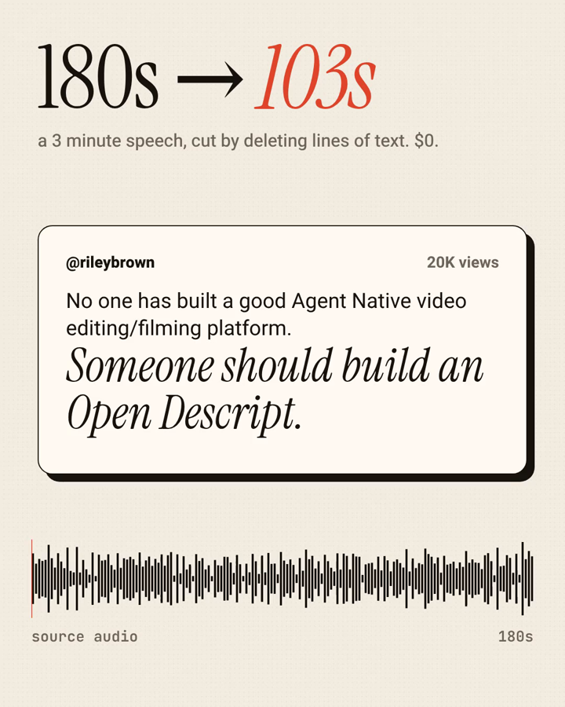

# scriptcut

Edit a video by editing its transcript. An open, agent-native take on the Descript workflow:
the edit surface is a plain text file, so Claude Code, Codex or any coding agent edits video
with the same file tools it already uses for code. No agent service in the middle, no per-edit fee,
everything runs on your machine.



Inspired by [@rileybrown's post](https://x.com/rileybrown/status/2103889350354145698) asking for an open Descript that agents can drive.

## Measured

A real public-domain speech (President Kennedy at Rice University, 1962, 3 minutes from Wikimedia Commons).
The edit: cut every third sentence line (10 of 30). Then the output was transcribed again from scratch
to check the cut by ear, not by timestamps.

| | |
|---|---|
| Source | 180.0 s |
| Output | 103.4 s, 34 spans, pauses over 0.4 s tightened |
| Kept words heard in the output | **248 of 250 (99.2%)** |
| Cut sentences still audible | **0 of 10** |
| Render (ffmpeg, frame-accurate) | 3.5 s |
| Transcribe (whisper small, CPU) | 84 s |
| API cost | $0 |

Reproduce: `python scriptcut.py transcribe clip.mp4 && python bench/bench.py clip.mp4` (raw numbers in `bench/result.json`).

## Use

```
pip install openai-whisper          # only needed for transcribe; ffmpeg must be on PATH
python scriptcut.py transcribe talk.mp4          # talk.words.json + talk.edit.txt
# edit talk.edit.txt: delete a line to cut a sentence, delete words to cut words
python scriptcut.py plan talk.mp4 --max-gap 0.4 --no-fillers   # JSON cut list, nothing rendered
python scriptcut.py render talk.mp4 -o cut.mp4 --max-gap 0.4 --no-fillers
```

The edit file:

```
[0003] The greater our knowledge increases, the greater our ignorance unfolds.
[0004] Despite the striking fact that most of the scientists that the world has ever known are
```

Telling an agent "cut the part about population growth and remove the ums" is enough: it edits the
text file, runs `plan` to check the JSON, then `render`. Every command prints JSON.

## How it works

Whisper gives word timestamps. Your edited lines are aligned back to the original words
(difflib, per line), surviving words become time spans, neighbours stay joined with their natural
pause unless it exceeds `--max-gap`, and ffmpeg trims and concatenates video and audio in one pass.
One Python file, stdlib plus ffmpeg.

```
python -m unittest discover -s tests
```

Built with Claude Opus 5.5. MIT license.
